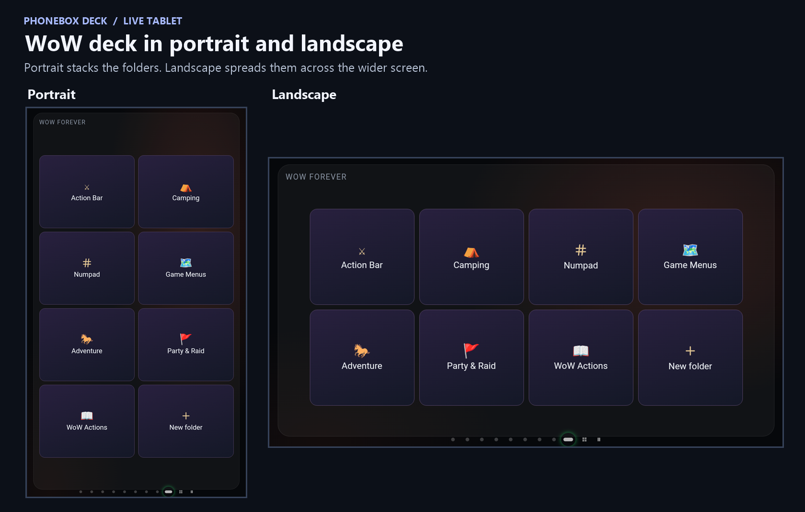
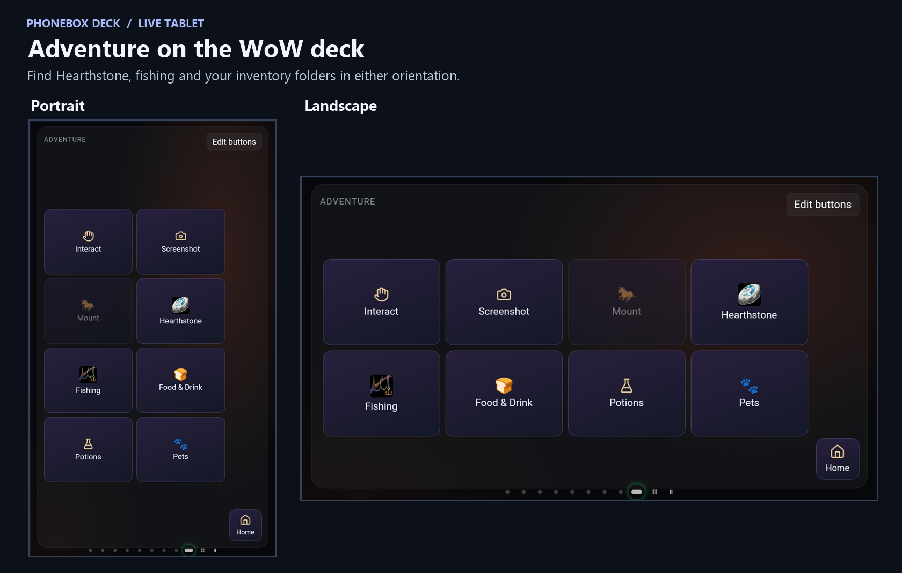
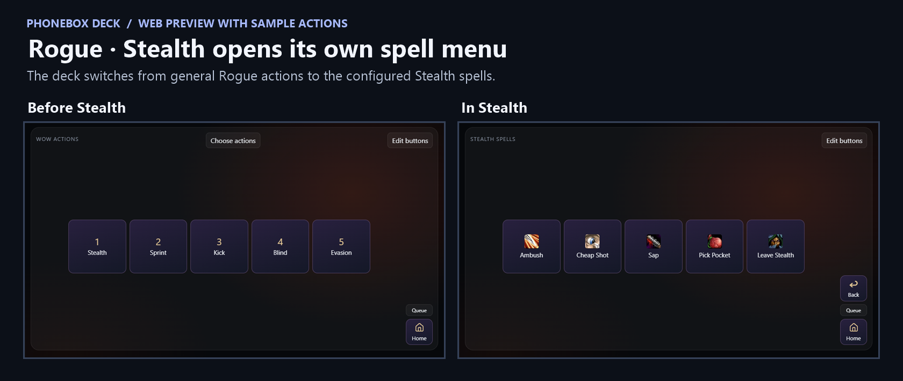
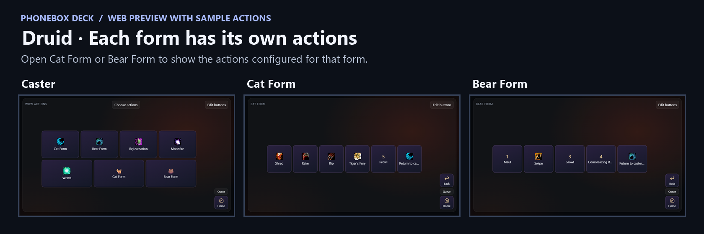

# PhoneBox Deck screenshots

## WoW deck and Adventure

Captured on the same Vizio XR6M10 with WoW Forever in the foreground. The home and Adventure panels use two columns in portrait and four in landscape.

## Rogue Stealth

This web preview uses sample actions. Stealth opens the configured Stealth Spells folder with Ambush, Cheap Shot, Sap and Pick Pocket. **Leave Stealth** is in the same folder.

## Druid forms

This web preview uses sample actions. **Cat Form** opens a folder with actions such as Shred, Rake and Rip. **Bear Form** shows a different set, including Maul, Swipe and Growl.

